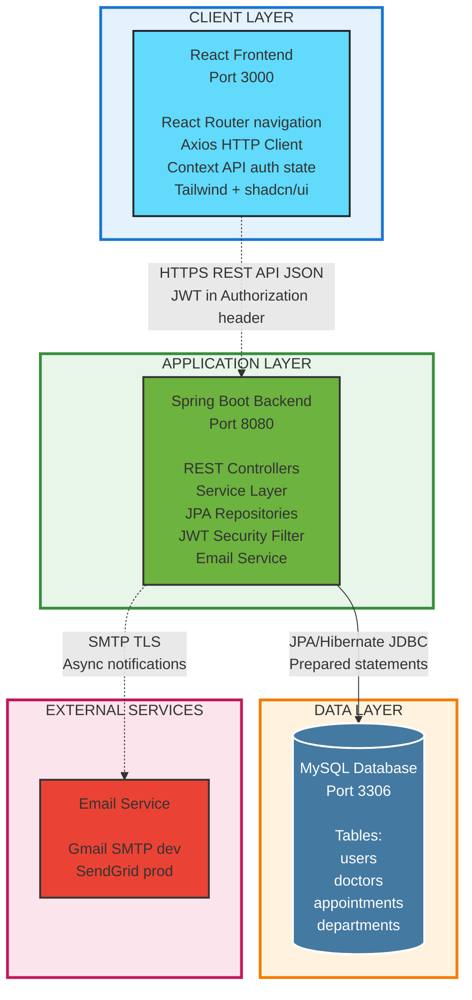
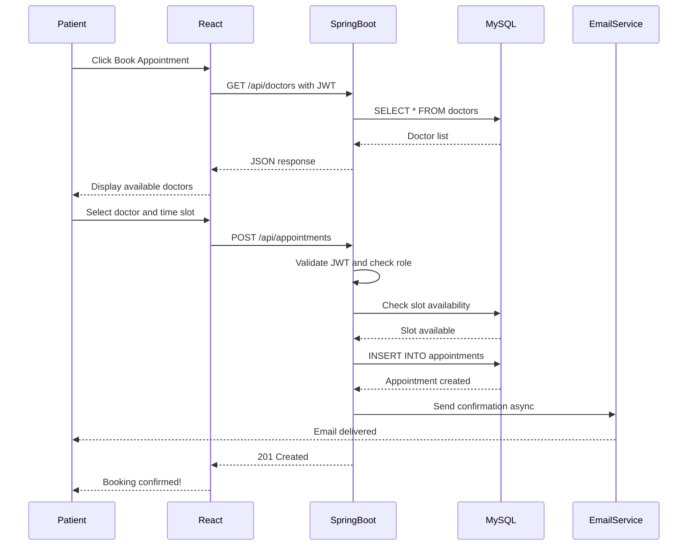

# System Architecture - Hospital Booking System

> **Project:** Hospital Appointment Booking System  
> **Student:** Najm (2356070)  
> **Supervisor:** Steve Counsell  
> **Date:** December 20, 2025

---

## Architecture Diagram



---

## Component Description

### 1. Client Layer (Frontend)

**Technology Stack:**

- React 18+ with functional components and hooks
- React Router v6 for client-side navigation
- Axios for HTTP requests with JWT interceptor
- Context API for global authentication state
- Tailwind CSS + shadcn/ui for styling

**Key Responsibilities:**

- User interface rendering (Patient/Doctor/Admin dashboards)
- Form validation and user input handling
- JWT token storage and management
- API communication with backend

---

### 2. Application Layer (Backend)

**Technology Stack:**

- Spring Boot 3.x
- Spring Security with JWT authentication
- Spring Data JPA + Hibernate ORM
- Spring Boot Starter Mail for email notifications
- BCrypt for password hashing

**Architecture Pattern:** Layered (MVC-style)

- **Controllers:** REST API endpoints (`/api/auth`, `/api/appointments`, etc.)
- **Services:** Business logic (booking validation, availability checking)
- **Repositories:** Database access layer with Spring Data JPA
- **Security:** JWT authentication filter + role-based access control

**Key Responsibilities:**

- Request authentication and authorization (JWT validation)
- Business logic implementation (appointment booking rules)
- Database operations (CRUD via JPA)
- Email notification triggering

---

### 3. Data Layer (Database)

**Technology:** MySQL 8.0+

**Core Tables:**

- `users` - Patient, Doctor, Admin accounts with role-based access
- `doctors` - Doctor profiles, specialties, qualifications, availability
- `appointments` - Booking records with date/time, status, notes
- `departments` - Medical departments and specialties

**Database Features:**

- Unique constraint on `(doctor_id, appointment_date, start_time)` prevents double booking
- Foreign key constraints for referential integrity
- Indexes on frequently queried columns (email, doctor_id, appointment_date)
- BCrypt password hashing for security (NFR-2.1)

---

### 4. External Services

**Email Service:**

- **Development:** Gmail SMTP (port 587, TLS)
- **Production:** SendGrid or AWS SES
- **Purpose:** Booking confirmations, cancellations, reminders (FR-4.1)
- **Implementation:** Asynchronous with retry mechanism (NFR-10.1)

---

## Security Architecture

### Authentication Flow

1. User submits credentials → Backend validates with BCrypt
2. JWT token generated (24-hour expiry) containing user ID + role
3. Frontend stores token in localStorage
4. Token sent in `Authorization: Bearer <token>` header on all requests
5. Backend `JwtAuthenticationFilter` validates token
6. Request proceeds if token valid + user has required role

### Role-Based Access Control (RBAC)

| Role        | Permissions                                                            |
| ----------- | ---------------------------------------------------------------------- |
| **Patient** | Book appointments, view own appointments, cancel/reschedule            |
| **Doctor**  | View schedule, manage availability, mark appointment status, add notes |
| **Admin**   | Full system access (user management, analytics, reports)               |

---

## Data Flow: Appointment Booking



---

## Technology Justification

### Why React?

- Component-based architecture for reusable UI (NFR-5.3)
- Large ecosystem with shadcn/ui for rapid development
- Easy integration with Spring Boot REST API

### Why Spring Boot?

- Industry-standard Java framework
- Built-in security (Spring Security + JWT)
- Excellent ORM support (Hibernate/JPA)
- Production-ready features (logging, monitoring)

### Why MySQL?

- ACID compliance for transaction safety (NFR-3.3)
- Wide industry adoption and support
- Compatible with JPA for database portability (NFR-6.2)

### Why JWT?

- Stateless authentication enables horizontal scaling (NFR-5.2)
- No server-side session storage required
- Standard industry practice for REST APIs

---

## Non-Functional Requirements Mapping

| NFR                                | Implementation                                            |
| ---------------------------------- | --------------------------------------------------------- |
| **NFR-2.1** (Authentication)       | JWT Security Filter + BCrypt password hashing             |
| **NFR-2.2** (Data Protection)      | HTTPS/TLS, prepared statements (SQL injection prevention) |
| **NFR-3.3** (Data Integrity)       | Database transactions, unique constraints                 |
| **NFR-4.1** (Responsive UI)        | Tailwind CSS mobile-first approach                        |
| **NFR-5.1** (Code Quality)         | Layered architecture (Controller → Service → Repository)  |
| **NFR-5.2** (Scalability)          | Stateless REST API, horizontal scaling capability         |
| **NFR-6.2** (Database Portability) | JPA abstraction (H2 dev, MySQL prod)                      |
| **NFR-10.1** (Email Reliability)   | Async delivery, retry mechanism                           |

---

## API Endpoints (Examples)

| Method | Endpoint                         | Description            | Access        |
| ------ | -------------------------------- | ---------------------- | ------------- |
| POST   | `/api/auth/register`             | User registration      | Public        |
| POST   | `/api/auth/login`                | JWT token generation   | Public        |
| GET    | `/api/doctors`                   | List all doctors       | Authenticated |
| GET    | `/api/doctors/{id}/availability` | Get available slots    | Authenticated |
| POST   | `/api/appointments`              | Book appointment       | Patient       |
| GET    | `/api/appointments/my`           | Patient's appointments | Patient       |
| PUT    | `/api/appointments/{id}`         | Reschedule/cancel      | Patient       |
| GET    | `/api/doctor/schedule`           | Doctor's schedule      | Doctor        |
| POST   | `/api/doctor/availability`       | Set availability       | Doctor        |
| GET    | `/api/admin/users`               | User management        | Admin         |
| GET    | `/api/admin/analytics`           | System statistics      | Admin         |

---

## Deployment Architecture

### Development Environment

- **Frontend:** `localhost:3000` (Vite dev server)
- **Backend:** `localhost:8080` (Spring Boot embedded Tomcat)
- **Database:** `localhost:3306` (MySQL local instance)
- **Email:** Gmail SMTP for testing

### Production Environment (Optional)

- **Frontend:** Vercel/Netlify (static hosting)
- **Backend:** AWS EC2, Railway, or Heroku
- **Database:** AWS RDS MySQL or PlanetScale
- **Email:** SendGrid or AWS SES

---

## Project File Structure

### Backend (Spring Boot)

```
src/main/java/com/hospital/booking/
├── controller/          (REST API endpoints)
│   ├── AuthController.java
│   ├── AppointmentController.java
│   ├── DoctorController.java
│   └── AdminController.java
├── service/             (Business logic)
│   ├── AuthService.java
│   ├── AppointmentService.java
│   ├── EmailService.java
│   └── UserService.java
├── repository/          (Database access - JPA)
│   ├── UserRepository.java
│   ├── AppointmentRepository.java
│   ├── DoctorRepository.java
│   └── TimeSlotRepository.java
├── model/               (JPA entities)
│   ├── User.java
│   ├── Doctor.java
│   ├── Appointment.java
│   ├── Department.java
│   └── TimeSlot.java
├── dto/                 (Data transfer objects)
│   ├── LoginRequest.java
│   ├── AppointmentDTO.java
│   └── UserDTO.java
├── security/            (Authentication & authorization)
│   ├── JwtUtil.java
│   ├── SecurityConfig.java
│   └── JwtAuthenticationFilter.java
└── exception/           (Error handling)
    └── GlobalExceptionHandler.java
```

### Frontend (React)

```
src/
├── components/
│   ├── auth/
│   │   ├── LoginForm.jsx
│   │   └── RegisterForm.jsx
│   ├── patient/
│   │   ├── PatientDashboard.jsx
│   │   ├── BookAppointment.jsx
│   │   └── AppointmentHistory.jsx
│   ├── doctor/
│   │   ├── DoctorDashboard.jsx
│   │   ├── ManageAvailability.jsx
│   │   └── ViewSchedule.jsx
│   └── admin/
│       ├── AdminDashboard.jsx
│       ├── UserManagement.jsx
│       └── Analytics.jsx
├── services/
│   ├── authService.js (login, register, JWT handling)
│   ├── appointmentService.js (CRUD operations)
│   └── userService.js (user management)
├── context/
│   └── AuthContext.jsx (global auth state)
└── utils/
    └── axiosConfig.js (JWT interceptor)
```

---

## Document Version

**Version:** 1.0  
**Last Updated:** December 20, 2025  
**Status:** Sprint 1 - Requirements & Design Phase
