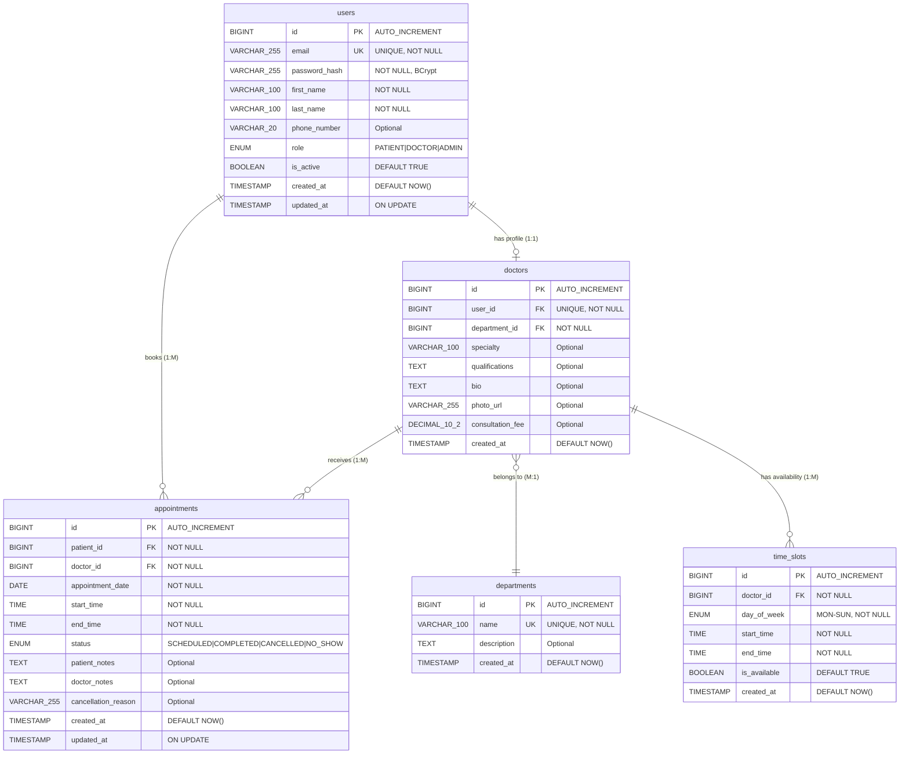

# Hospital Booking System - Entity-Relationship Diagram

> **Project:** Hospital Appointment Booking System
> **Student:** Najm (2356070)
> **Supervisor:** Steve Counsell
> **Date:** January 12, 2026
> **Sprint:** Sprint 1 - Dev Task 9

---

## Complete ER Diagram



---

## Relationship Details

### 1. users ↔ doctors (One-to-One)

**Cardinality:** 1:1 (Optional)

- **Description:** A user with `role='DOCTOR'` can have one doctor profile
- **Foreign Key:** `doctors.user_id` → `users.id`
- **Constraints:**
  - `UNIQUE` on `doctors.user_id` (one doctor profile per user)
  - `CASCADE DELETE`: If user account deleted, doctor profile also deleted
- **Business Rule:** Only users with `role='DOCTOR'` should have a corresponding entry in `doctors` table

**SQL:**
```sql
ALTER TABLE doctors
ADD CONSTRAINT fk_doctors_user
FOREIGN KEY (user_id) REFERENCES users(id)
ON DELETE CASCADE;
```

---

### 2. doctors ↔ departments (Many-to-One)

**Cardinality:** M:1

- **Description:** Many doctors belong to one department
- **Foreign Key:** `doctors.department_id` → `departments.id`
- **Constraints:**
  - `NOT NULL` (every doctor must have a department)
  - `RESTRICT DELETE`: Cannot delete department if doctors exist
- **Business Rule:** Departments like "Cardiology", "Dermatology" group related doctors

**SQL:**
```sql
ALTER TABLE doctors
ADD CONSTRAINT fk_doctors_department
FOREIGN KEY (department_id) REFERENCES departments(id)
ON DELETE RESTRICT;
```

---

### 3. doctors ↔ time_slots (One-to-Many)

**Cardinality:** 1:M

- **Description:** One doctor has many availability time slots (weekly schedule)
- **Foreign Key:** `time_slots.doctor_id` → `doctors.id`
- **Constraints:**
  - Composite `UNIQUE` on `(doctor_id, day_of_week, start_time)` - prevents duplicate slots
  - `CASCADE DELETE`: If doctor deleted, all time slots deleted
- **Business Rule:** Defines when doctor is available for appointments (e.g., Mon 9:00-17:00, Tue 10:00-14:00)

**SQL:**
```sql
ALTER TABLE time_slots
ADD CONSTRAINT fk_timeslots_doctor
FOREIGN KEY (doctor_id) REFERENCES doctors(id)
ON DELETE CASCADE;

ALTER TABLE time_slots
ADD CONSTRAINT uk_timeslot_unique
UNIQUE (doctor_id, day_of_week, start_time);
```

---

### 4. users ↔ appointments (One-to-Many, as Patient)

**Cardinality:** 1:M

- **Description:** One patient (user) can book many appointments
- **Foreign Key:** `appointments.patient_id` → `users.id`
- **Constraints:**
  - `NOT NULL` (every appointment must have a patient)
  - `RESTRICT DELETE`: Cannot delete user if appointments exist (use soft delete instead)
- **Business Rule:** Patients track appointment history

**SQL:**
```sql
ALTER TABLE appointments
ADD CONSTRAINT fk_appointments_patient
FOREIGN KEY (patient_id) REFERENCES users(id)
ON DELETE RESTRICT;
```

---

### 5. doctors ↔ appointments (One-to-Many)

**Cardinality:** 1:M

- **Description:** One doctor receives many appointments
- **Foreign Key:** `appointments.doctor_id` → `doctors.id`
- **Constraints:**
  - `NOT NULL` (every appointment must have a doctor)
  - Composite `UNIQUE` on `(doctor_id, appointment_date, start_time)` - **prevents double booking**
  - `RESTRICT DELETE`: Cannot delete doctor if appointments exist
- **Business Rule:** Doctors manage daily schedules

**SQL:**
```sql
ALTER TABLE appointments
ADD CONSTRAINT fk_appointments_doctor
FOREIGN KEY (doctor_id) REFERENCES doctors(id)
ON DELETE RESTRICT;

ALTER TABLE appointments
ADD CONSTRAINT uk_appointment_no_double_booking
UNIQUE (doctor_id, appointment_date, start_time);
```

---

## Cardinality Summary

| Relationship | Notation | Description |
|---|---|---|
| **users ──(1:1)──▶ doctors** | `\|\|--o\|` | One user optionally has one doctor profile |
| **doctors ──(M:1)──▶ departments** | `}o--\|\|` | Many doctors belong to one department |
| **doctors ──(1:M)──▶ time_slots** | `\|\|--o{` | One doctor has many time slots |
| **users ──(1:M)──▶ appointments** | `\|\|--o{` | One patient books many appointments |
| **doctors ──(1:M)──▶ appointments** | `\|\|--o{` | One doctor receives many appointments |

**Legend:**
- `||` = Exactly one (mandatory)
- `o|` = Zero or one (optional)
- `}o` = Zero or more (optional many)
- `o{` = Zero or more (optional many)

---

## Detailed Entity Diagrams

### users Entity

```
┌─────────────────────────────────────────────────┐
│                     users                       │
├─────────────────────────────────────────────────┤
│ PK  id                    BIGINT                │
│ UK  email                 VARCHAR(255)          │
│     password_hash         VARCHAR(255)          │
│     first_name            VARCHAR(100)          │
│     last_name             VARCHAR(100)          │
│     phone_number          VARCHAR(20)           │
│     role                  ENUM(PATIENT,DOCTOR,  │
│                               ADMIN)            │
│     is_active             BOOLEAN               │
│     created_at            TIMESTAMP             │
│     updated_at            TIMESTAMP             │
└─────────────────────────────────────────────────┘
         │                        │
         │ 1:1                    │ 1:M
         ▼                        ▼
    doctors              appointments (as patient)
```

---

### departments Entity

```
┌─────────────────────────────────────────────────┐
│                 departments                     │
├─────────────────────────────────────────────────┤
│ PK  id                    BIGINT                │
│ UK  name                  VARCHAR(100)          │
│     description           TEXT                  │
│     created_at            TIMESTAMP             │
└─────────────────────────────────────────────────┘
         ▲
         │ M:1
         │
    doctors (many doctors belong here)
```

---

### doctors Entity

```
┌─────────────────────────────────────────────────┐
│                   doctors                       │
├─────────────────────────────────────────────────┤
│ PK  id                    BIGINT                │
│ FK  user_id               BIGINT (UNIQUE)       │
│ FK  department_id         BIGINT                │
│     specialty             VARCHAR(100)          │
│     qualifications        TEXT                  │
│     bio                   TEXT                  │
│     photo_url             VARCHAR(255)          │
│     consultation_fee      DECIMAL(10,2)         │
│     created_at            TIMESTAMP             │
└─────────────────────────────────────────────────┘
         │                        │
         │ 1:M                    │ 1:M
         ▼                        ▼
    time_slots            appointments
```

---

### time_slots Entity

```
┌─────────────────────────────────────────────────┐
│                 time_slots                      │
├─────────────────────────────────────────────────┤
│ PK  id                    BIGINT                │
│ FK  doctor_id             BIGINT                │
│     day_of_week           ENUM(MONDAY-SUNDAY)   │
│     start_time            TIME                  │
│     end_time              TIME                  │
│     is_available          BOOLEAN               │
│     created_at            TIMESTAMP             │
├─────────────────────────────────────────────────┤
│ UK  (doctor_id, day_of_week, start_time)        │
└─────────────────────────────────────────────────┘
```

**Example Data:**
```
doctor_id=1, day_of_week=MONDAY, start_time=09:00, end_time=17:00
→ System generates 30-min slots: 09:00, 09:30, 10:00, ..., 16:30
```

---

### appointments Entity

```
┌─────────────────────────────────────────────────┐
│                appointments                     │
├─────────────────────────────────────────────────┤
│ PK  id                    BIGINT                │
│ FK  patient_id            BIGINT                │
│ FK  doctor_id             BIGINT                │
│     appointment_date      DATE                  │
│     start_time            TIME                  │
│     end_time              TIME                  │
│     status                ENUM(SCHEDULED,       │
│                               COMPLETED,        │
│                               CANCELLED,        │
│                               NO_SHOW)          │
│     patient_notes         TEXT                  │
│     doctor_notes          TEXT                  │
│     cancellation_reason   VARCHAR(255)          │
│     created_at            TIMESTAMP             │
│     updated_at            TIMESTAMP             │
├─────────────────────────────────────────────────┤
│ UK  (doctor_id, appointment_date, start_time)   │
└─────────────────────────────────────────────────┘
```

**Double Booking Prevention:**
The unique constraint `(doctor_id, appointment_date, start_time)` ensures a doctor cannot have two appointments at the same time.

---

## Key Indexes for Performance

### Primary Keys
All tables use `BIGINT AUTO_INCREMENT` for scalability

### Unique Indexes
- `users.email` - Fast login lookups
- `departments.name` - Prevent duplicate departments
- `doctors.user_id` - One doctor profile per user
- `time_slots(doctor_id, day_of_week, start_time)` - No duplicate slots
- `appointments(doctor_id, appointment_date, start_time)` - **No double booking**

### Foreign Key Indexes
- `doctors.department_id` - Filter doctors by department
- `time_slots.doctor_id` - Fetch doctor availability
- `appointments.patient_id` - Patient appointment history
- `appointments.doctor_id` - Doctor daily schedule
- `appointments.appointment_date` - Date range queries

---

## Business Rules Enforced by Schema

### 1. No Double Booking
**Constraint:** `UNIQUE (doctor_id, appointment_date, start_time)`
**Prevents:** Doctor having multiple appointments at the same time

### 2. No Duplicate Time Slots
**Constraint:** `UNIQUE (doctor_id, day_of_week, start_time)`
**Prevents:** Duplicate availability entries for the same time

### 3. Role-Based Doctor Profiles
**Logic:** Only users with `role='DOCTOR'` should have `doctors` entry
**Enforced:** Application layer (JPA validation)

### 4. Soft Delete Users
**Field:** `users.is_active`
**Purpose:** Mark accounts inactive instead of deleting (preserves appointment history)

### 5. Appointment Status Lifecycle
**Valid Transitions:**
```
SCHEDULED → COMPLETED
SCHEDULED → CANCELLED
SCHEDULED → NO_SHOW
```
**Enforced:** Application layer business logic

### 6. Cascading Deletes
- Delete user → Delete doctor profile (CASCADE)
- Delete doctor → Delete time slots (CASCADE)
- Delete user/doctor → **BLOCK** if appointments exist (RESTRICT)

---

## Sample Data Walkthrough

### Scenario: Patient Sarah books appointment with Dr. Thompson

**Step 1: User Registration**
```sql
INSERT INTO users (email, password_hash, first_name, last_name, role)
VALUES ('sarah.chen@email.com', '$2a$10$...', 'Sarah', 'Chen', 'PATIENT');
-- user_id = 1

INSERT INTO users (email, password_hash, first_name, last_name, role)
VALUES ('dr.thompson@hospital.com', '$2a$10$...', 'Emily', 'Thompson', 'DOCTOR');
-- user_id = 2
```

**Step 2: Department Creation**
```sql
INSERT INTO departments (name, description)
VALUES ('Cardiology', 'Heart and cardiovascular system');
-- department_id = 1
```

**Step 3: Doctor Profile Creation**
```sql
INSERT INTO doctors (user_id, department_id, specialty, bio, consultation_fee)
VALUES (2, 1, 'General Cardiology', 'Dr. Thompson specializes in...', 150.00);
-- doctor_id = 1
```

**Step 4: Doctor Sets Availability**
```sql
INSERT INTO time_slots (doctor_id, day_of_week, start_time, end_time)
VALUES (1, 'MONDAY', '09:00', '17:00');

INSERT INTO time_slots (doctor_id, day_of_week, start_time, end_time)
VALUES (1, 'WEDNESDAY', '10:00', '14:00');
```

**Step 5: Patient Books Appointment**
```sql
INSERT INTO appointments (patient_id, doctor_id, appointment_date, start_time, end_time, status, patient_notes)
VALUES (1, 1, '2025-12-25', '09:00', '09:30', 'SCHEDULED', 'Chest pain for 2 weeks');
-- appointment_id = 1
```

**Step 6: Doctor Completes Appointment**
```sql
UPDATE appointments
SET status = 'COMPLETED', doctor_notes = 'Prescribed beta-blockers. Follow-up in 2 weeks.'
WHERE id = 1;
```

---

## Schema Validation Queries

### 1. Verify One-to-One (User-Doctor)
```sql
-- Should return 0 (each user has max 1 doctor profile)
SELECT user_id, COUNT(*) as profiles
FROM doctors
GROUP BY user_id
HAVING COUNT(*) > 1;
```

### 2. Verify No Double Booking
```sql
-- Should return 0 (no doctor has overlapping appointments)
SELECT a1.doctor_id, a1.appointment_date, a1.start_time
FROM appointments a1
JOIN appointments a2 ON a1.doctor_id = a2.doctor_id
    AND a1.appointment_date = a2.appointment_date
    AND a1.start_time = a2.start_time
    AND a1.id != a2.id;
```

### 3. Verify Role Consistency
```sql
-- Should return 0 (only DOCTOR role users have doctor profiles)
SELECT d.id, u.role
FROM doctors d
JOIN users u ON d.user_id = u.id
WHERE u.role != 'DOCTOR';
```

---

## Schema Migration Notes

### Spring Boot JPA Auto-Generation
With `spring.jpa.hibernate.ddl-auto=update`, Hibernate will:
- ✅ Create tables from `@Entity` classes
- ✅ Add columns for new fields
- ✅ Create indexes from `@Table(indexes=...)`
- ❌ **Will NOT** drop columns or tables (safe for production)

### Production Migration Strategy
For production, use **Flyway** or **Liquibase**:

**Example Flyway Migration (V1__init_schema.sql):**
```sql
CREATE TABLE users (
    id BIGINT AUTO_INCREMENT PRIMARY KEY,
    email VARCHAR(255) NOT NULL UNIQUE,
    password_hash VARCHAR(255) NOT NULL,
    -- ... rest of schema
);

-- Add foreign keys after all tables created
ALTER TABLE doctors ADD CONSTRAINT fk_doctors_user
FOREIGN KEY (user_id) REFERENCES users(id) ON DELETE CASCADE;
```

---

## Next Steps (Sprint 1)

1. ✅ **Dev 9 (Current):** Create ER diagram - **COMPLETED**
2. Create JPA entity classes (`@Entity`, `@Table`, `@Column`)
3. Define relationships (`@OneToOne`, `@ManyToOne`, `@OneToMany`)
4. Add validation annotations (`@NotNull`, `@Email`, `@Size`)
5. Create repository interfaces (`JpaRepository<Entity, Long>`)
6. Configure `application.properties` with database connection
7. Test schema generation with `spring.jpa.hibernate.ddl-auto=create-drop`

---

## Document Information

**Version:** 2.0
**Last Updated:** January 12, 2026
**Status:** Sprint 1 - Dev Task 9 Complete
**Tools Used:** Mermaid ER Diagram
**Related Documents:**
- [database-schema.md](../database-schema.md) - Detailed table schemas
- [architecture.md](../architecture.md) - System architecture
